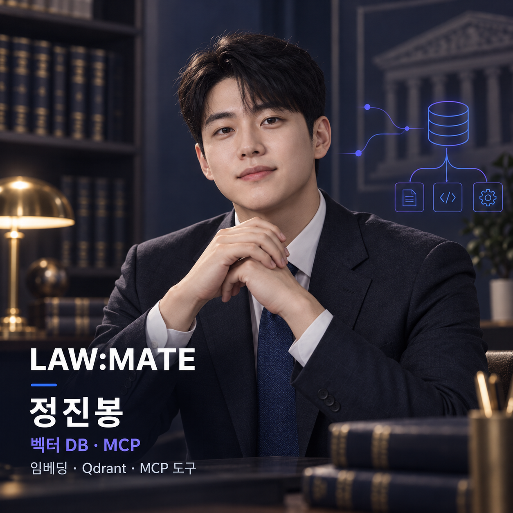

# LAW:MATE

### 법률 용어 대신, 당신의 상황을 이야기하세요.

공식 법령·생활법률 안내 문서와 판례를 검색해 생활 속 법률 고민의 대응 방향과 근거를 안내하는 웹 서비스

**SK Networks Family AI Camp 35기 · 4차 프로젝트 · 3팀**

  
  
  
  

  
  
  
  

[프로젝트 소개](#overview) · [주요 기능](#features) · [아키텍처](#architecture) · [평가 결과](#evaluation) · [실행 방법](#quickstart)

| 원본 문서 | 부모 근거 단위 | 검색 청크 | 저장된 RAG 평가 |
| :---: | :---: | :---: | :---: |
| **125개** | **3,694개** | **4,276개** | **29/29 성공** |

> 위 수치는 현재 저장소의 데이터 보고서와 평가 결과 파일 기준입니다. 외부 OpenAI·Qdrant·판례 API를 포함한 운영 환경의 실시간 상태를 뜻하지 않습니다.

## 목차

1. [프로젝트 소개](#overview)
2. [팀 구성과 역할](#team)
3. [주요 기능과 사용 흐름](#features)
4. [3차에서 4차로의 고도화](#upgrade)
5. [시스템 아키텍처](#architecture)
6. [핵심 구현](#implementation)
7. [데이터 구성과 전처리](#data)
8. [평가 결과](#evaluation)
9. [기술 스택](#stack)
10. [로컬 실행](#quickstart)
11. [데이터 처리와 테스트](#testing)
12. [디렉터리 구조](#structure)
13. [구현 상태와 한계](#limitations)
14. [문서 모음](#documents)

## 1. 프로젝트 소개

법률 분쟁을 겪는 사용자는 자신의 상황을 어떤 용어로 검색해야 하는지 알기 어렵습니다. 하나의 질문에도 해고의 적법성, 미지급 임금, 구제 절차처럼 서로 다른 쟁점이 함께 포함될 수 있습니다.

LAW:MATE는 **상황 입력 → 질문 분석 → 법령·판례 검색 → 근거 검증 → 답변과 출처 확인**을 하나의 상담 흐름으로 연결합니다. 3차 프로젝트의 데이터·RAG 기반을 이어받아 4차에서는 Django 웹 구조, 조건형 검색 전략, 판례 검색·비교 MCP, 주장과 근거의 의미 검증을 구체화했습니다.

| 사용자가 겪는 어려움 | 프로젝트의 접근 |
| --- | --- |
| 일상 표현과 법률 문서의 표현이 다름 | 질문 재작성과 Multi-query로 검색 표현 확장 |
| 한 질문에 여러 법률 쟁점이 섞임 | Query Planner가 검색 전략을 선택하고 해결 목적별 질의 생성 |
| 정확한 용어와 문맥 유사성을 함께 찾아야 함 | Dense·BM25 결과를 RRF로 결합하고 재정렬 |
| 짧은 청크만으로 조건·예외를 놓칠 수 있음 | 검색 청크를 부모 근거·원문 위치와 연결 |
| 출처가 실제 주장을 뒷받침하는지 확인하기 어려움 | 출처 ID 검사와 LLM 기반 주장-근거 검증을 분리 수행 |
| 판례 탐색과 기준 판례 비교의 목적이 다름 | MCP Tool을 유사 판례 검색과 기준 판례 비교로 분리 |

### 주요 상담 범위

- 주거·임대차: 전세·월세 계약, 보증금 반환, 계약 종료
- 소비자: 쇼핑 환불, 계약해지, 피해구제, 서비스 분쟁
- 근로: 임금체불, 부당해고, 아르바이트 근로 문제

이 프로젝트는 수집된 공식 자료를 근거로 생활법률 정보를 제공하는 프로토타입입니다. 개별 사건의 최종 법률 판단이나 결과를 보장하지 않으며, 사건 시점·계약 조건·예외 규정은 원문과 전문가를 통해 추가 확인해야 합니다.

## 2. 팀 구성과 역할

  
  
  
  

| 업무 | 정 담당 | 부 담당 | 담당 범위 |
| --- | :---: | :---: | --- |
| 데이터·요구사항 | 박민하 | 정은미 | 공식 자료 수집·전처리·청킹, 출처·조건 보존, 데이터 인계 |
| 벡터 DB·MCP·배포 환경 | 정진봉 | 박민하 | Qdrant 규격·적재 확인, 판례 MCP Tool, 실행·배포 환경 |
| RAG·응답 품질 | 정은미 | 김도영 | Planner·Multi-query·검색·재정렬·생성·인용 검증, 평가 |
| Django·화면·그래프 통합 | 김도영 | 정진봉 | HTML/CSS/JS, Django API, LangGraph 분기, 첨부 처리 |
| 통합 테스트·발표 | 전원 | 영역별 교차 검토 | 핵심·오류 시나리오 검증, 결과 기록, 시연 자료 |

세부 분담은 [4차 프로젝트 계획서](PLAN.md)를 기준으로 정리했습니다.

## 3. 주요 기능과 사용 흐름

| 기능 | 구현 내용 |
| --- | --- |
| Django 웹 상담 | 소개·이용 안내·상담 화면과 <code>POST /api/chat/</code> 상담 API |
| 텍스트·첨부 입력 | 자연어 질문, PNG·JPG·JPEG 이미지, PDF 첨부 |
| 첨부 제한 | 기본 파일당 10 MiB, PDF 최대 5페이지, 이미지 최대 3장 |
| 질문 분류 | 일반 대화, 법령 RAG, 판례 MCP, 서비스 범위 밖 질문으로 분기 |
| 조건형 RAG | Query Planner가 Rewrite·Multi-query 필요 여부를 판단 |
| 하이브리드 검색 | Dense·BM25 검색, RRF 통합, CrossEncoder 또는 검색 점수 기반 재정렬 |
| 부모 근거 조회 | 검색 청크에서 원문 조건·예외·위치를 담은 부모 근거로 연결 |
| 판례 MCP | 유사 판례 Top-N 검색, 기준 판례와 후보 판례의 유사도 비교 |
| 답변·인용 검증 | 주장별 출처 ID 확인과 근거의 의미 지원 여부 평가 |
| 결과 화면 | 답변, 출처, 처리 상태, 유사 판례와 비교 결과 표시 |

### 사용자 흐름

| 단계 | 사용자 동작 | 시스템 처리 |
| --- | --- | --- |
| 1. 상담 시작 | 상황과 원하는 해결 방향 입력 | 질문 유효성 검사 |
| 2. 자료 첨부 | 계약서·문자 이미지 또는 PDF 첨부 | 이미지 변환·설명 생성 |
| 3. 경로 선택 | 별도 조작 없이 질문 전송 | 일반·RAG·MCP·범위 밖 경로 분류 |
| 4. 근거 검색 | 처리 완료 대기 | 법령 RAG 또는 판례 MCP 수행 |
| 5. 답변 확인 | 답변과 처리 상태 확인 | 검색 근거를 이용한 답변 생성 |
| 6. 출처 검토 | 표시된 출처와 판례 확인 | 인용 구조·주장-근거 검증 결과 제공 |

### 화면 경로

| URL | 화면·기능 |
| --- | --- |
| <code>/</code> | 서비스 소개와 상담 시작 화면 |
| <code>/guide/</code> | 지원 주제와 이용 방법 안내 |
| <code>/chat/</code> | 질문·첨부·답변·출처를 확인하는 상담 화면 |
| <code>/api/chat/</code> | 웹 화면이 호출하는 POST 상담 API |

구현: [URL 연결](config/urls.py) · [상담 URL](apps/chat/urls.py) · [Django View](apps/chat/views.py) · [상담 화면](apps/chat/templates/chat/index.html)

## 4. 3차에서 4차로의 고도화

| 영역 | 3차 프로젝트 | 4차 프로젝트 |
| --- | --- | --- |
| 데이터 | 자료별 검색용 청크 생성 | 공통 처리 모듈과 부모 근거·조건·예외·원문 위치 연결 |
| RAG | 유사한 검색 단계를 순차 실행 | Query Planner가 질문별 Rewrite·Multi-query 필요 여부 선택 |
| Multi-query | 비슷한 검색 표현 확장 | 서로 다른 해결 목표와 법률 쟁점별 질의 생성 |
| 검색 | Dense·BM25 Hybrid 검색과 RRF | 경로별 결과·기여도 추적, RRF 최대 40개 후 최종 5개 재정렬 |
| 인용 | 출처 ID·본문·메타데이터 구조 검사 | 주장과 근거의 의미 지원 여부까지 평가 |
| MCP | 판례 자료 탐색 경로 | 유사 판례 검색과 기준 판례 비교 Tool 분리 |
| 웹 | Streamlit 기반 프로토타입 | HTML·CSS·JavaScript와 Django API로 화면·서버 역할 분리 |

이 표는 저장소 코드와 4차 발표자료에 기록된 구현 구조를 설명합니다. 성능 향상률이나 외부 서비스의 실시간 정상 동작을 의미하지 않습니다.

## 5. 시스템 아키텍처

~~~mermaid
flowchart LR
    U[사용자 질문 · 이미지 · PDF] --> W[Django Web UI HTML · CSS · JavaScript]
    W --> A[POST /api/chat/]
    A --> G[LangGraph Workflow]
    G --> I{첨부 이미지·PDF?}
    I -->|있음| V[이미지 설명]
    I -->|없음| C{질문 분류}
    V --> C
    C -->|general / out_of_scope| N[일반 안내]
    C -->|rag| R[RAG Subgraph]
    C -->|mcp| M[MCP Subgraph]
    R --> P[Query Planner]
    P --> Q[Rewrite · Multi-query]
    Q --> H[Dense + BM25]
    H --> F[RRF · Rerank]
    F --> E[부모 근거 확인 · 답변 생성]
    M --> T[유사 판례 검색 또는 기준 판례 비교]
    T --> X[Qdrant · 공식 판례 API 보완]
    X --> J[답변 생성]
    E --> K[Citation 검증]
    J --> K
    N --> O[JSON 응답]
    K --> O
    O --> W
~~~

- Django는 화면과 상담 요청을 담당하고, LangGraph는 첨부 처리·질문 분류·RAG/MCP 분기를 제어합니다.
- 법령 RAG는 Query Planner, 검색, 결합, 재정렬, 근거 검증, 생성 단계를 거칩니다.
- 판례 MCP는 질문 기반 유사 판례 검색과 기준 판례 비교를 구분합니다.
- OpenAI, Qdrant, 공식 판례 API는 실행 환경에 따라 연결되는 외부 의존성입니다.

구현: [메인 Workflow](src/graph/workflow.py) · [RAG Graph](src/graph/subgraphs/rag_graph/rag_graph.py) · [MCP Graph](src/graph/subgraphs/mcp_graph/graph.py)

## 6. 핵심 구현

### ① 질문별 검색 전략 선택

RAG 진입 후 Query Planner가 질문의 사실관계와 목적을 분석합니다. 질문을 다시 써야 하는지, 여러 검색 질의로 확장해야 하는지에 따라 <code>query_rewrite</code>, <code>multi_query</code>, <code>hybrid_search</code>로 분기합니다. Planner나 Rewrite가 실패하면 원문 질문을 사용해 검색을 이어갑니다.

구현: [Query Planner](src/rag/query_planner.py) · [질문 재작성](src/rag/query_rewrite.py) · [RAG 분기](src/graph/subgraphs/rag_graph/rag_graph.py)

### ② Dense·BM25 검색과 후보 정리

Dense 검색은 의미·문맥 유사성을, BM25는 법률 용어·조문 번호·키워드 일치를 찾습니다. 질의별 결과를 Hybrid Search로 모은 뒤 RRF로 순위를 통합하고, 최종 후보는 재정렬 단계를 거칩니다. 각 검색 경로와 순위·점수는 추적 정보로 남깁니다.

구현: [Dense 검색](src/rag/dense_search.py) · [BM25 검색](src/rag/bm25_search.py) · [Hybrid 검색](src/rag/hybrid_search.py) · [RRF](src/rag/rrf.py) · [재정렬](src/rag/rerank.py)

### ③ 검색 청크와 부모 근거 연결

청크에는 <code>parent_id</code>, 원문 범위, 제목, 위치, 출처 URL, 검색용 문맥 등의 메타데이터를 기록합니다. 짧은 검색 청크가 선택돼도 부모 근거를 다시 조회해 적용 조건·예외·원문 위치를 확인할 수 있도록 구성했습니다.

구현: [전처리](src/scripts/preprocess_data.py) · [청킹](src/scripts/chunk_data.py) · [부모 근거 조회](src/vector_db/evidence.py)

### ④ 판례 전용 MCP Tool

| Tool | 역할 |
| --- | --- |
| <code>find_similar_precedents</code> | 질문과 유사한 판례 Top-N 검색 |
| <code>compare_precedent_similarity</code> | 기준 판례와 후보 판례의 유사도 비교 |

Qdrant 판례 검색을 우선 사용하고, 기준 판례를 찾지 못한 경우 공식 판례 API를 보완 경로로 사용합니다. 유사도는 법률적 결론이나 승소 확률이 아닙니다.

구현: [MCP Runtime](src/tools/mcp_runtime.py) · [판례 서비스](src/tools/precedent_mcp.py) · [판례 API](src/tools/precedent_api.py) · [Qdrant 판례 검색](src/tools/qdrant_precedent.py)

### ⑤ 답변 생성과 Citation 검증

생성기는 검색 문서에서 답변·주장·출처 ID를 구조화합니다. Citation 단계는 먼저 출처 ID와 검색 문서의 연결을 검사하고, 각 문서가 실제 주장을 <code>supported</code>, <code>partial</code>, <code>unsupported</code> 중 어느 수준으로 지원하는지 평가합니다.

구현: [답변 생성](src/rag/generator.py) · [Citation 검증](src/rag/citation.py) · [Citation Node](src/graph/nodes/citation_node.py)

## 7. 데이터 구성과 전처리

| 항목 | 수량·설정 |
| --- | ---: |
| 원본 문서 | 125개 |
| 추출된 원본 | 124개 |
| 메타데이터·색인 전용 원본 | 1개 |
| 부모 근거 단위 | 3,694개 |
| 검색 제외 보관 근거 | 845개 |
| 검색 청크 | 4,276개 |
| 청크 본문 최대 길이 | 900자 |
| 청크 중복 구간 | 최대 100자 |
| 검색 입력 최대 길이 | 1,069자 |

~~~text
공식 원본
 → 텍스트·표 추출
 → 출처·조건·예외·원문 위치를 포함한 부모 근거 생성
 → 검색 청크 생성
 → Dense 임베딩 + BM25 Sparse 벡터
 → Qdrant 적재
~~~

데이터 주제는 소비자 환불·계약해지, 전세·월세·보증금 반환, 아르바이트 임금체불·해고를 중심으로 구성했습니다. 판례 MCP가 사용하는 판례 자료는 위 전처리 집계와 별도로 관리됩니다.

근거: [데이터 파이프라인](docs/rag_pipeline.md) · [전처리 품질 보고서](docs/data_reports/quality_report.json) · [청킹 보고서](docs/data_reports/chunking_report.json)

## 8. 평가 결과

<code>tests/rag/result/summary.csv</code>에 저장된 29개 평가 사례의 결과입니다.

| 단계 | 지표 | @5 | @10 |
| --- | --- | ---: | ---: |
| RRF | Hit | 0.897 | **1.000** |
| RRF | Recall | 0.242 | 0.416 |
| RRF | MRR | 0.741 | 0.757 |
| RRF | NDCG | 0.395 | 0.416 |
| Rerank | Hit | **1.000** | **1.000** |
| Rerank | Recall | 0.303 | 0.464 |
| Rerank | MRR | **0.880** | **0.880** |
| Rerank | NDCG | 0.527 | 0.500 |

- 전체 29개 사례가 실행 결과 파일에 성공으로 기록돼 있습니다.
- <code>unjudged@10</code>은 RRF 0.569, Rerank 0.521입니다. 평가되지 않은 후보가 포함된 상태이므로 Hit·Recall과 함께 해석해야 합니다.
- 이 값은 해당 평가 데이터·모델·컬렉션을 사용한 저장 결과이며 운영 환경의 지속적인 성능을 보장하지 않습니다.

평가 파일: [요약](tests/rag/result/summary.csv) · [질의별 결과](tests/rag/result/per_query.csv) · [추적 로그](tests/rag/result/traces.jsonl)

## 9. 기술 스택

| 구분 | 기술 |
| --- | --- |
| Language | Python 3.12, JavaScript, HTML, CSS |
| Web | Django 5.2.7, Django Template, Fetch API |
| AI Workflow | LangChain, LangGraph |
| LLM·Embedding | OpenAI <code>gpt-5-nano</code>, <code>text-embedding-3-small</code> 1536차원 |
| Search | Qdrant, Dense Search, FastEmbed BM25 Sparse, RRF |
| Rerank | Sentence Transformers CrossEncoder 또는 검색 점수 fallback |
| MCP | MCP SDK 2.x, 판례 검색·비교 Tool |
| File Processing | PyMuPDF, pdfplumber, lxml |
| Test | pytest, pytest-django |
| Package | uv |

## 10. 로컬 실행

### 10-1. 저장소와 의존성 준비

~~~powershell
git clone https://github.com/SKNETWORKS-FAMILY-AICAMP/SKN35-4th-3Team.git
cd SKN35-4th-3Team
git switch jb

uv sync --group dev
Copy-Item .env.example .env
~~~

재정렬 모델을 직접 사용하려면 <code>uv sync --group dev --group rerank</code>를 실행합니다.

### 10-2. 환경변수 설정

<code>.env</code>에서 최소한 다음 값을 실행 환경에 맞게 설정합니다. 실제 키는 저장소에 커밋하지 않습니다.

~~~dotenv
DJANGO_SECRET_KEY=...
DJANGO_ALLOWED_HOSTS=127.0.0.1,localhost
DJANGO_DEBUG=True

OPENAI_API_KEY=...
OPENAI_MODEL=gpt-5-nano
OPENAI_EMBEDDING_MODEL=text-embedding-3-small
EMBEDDING_DIMENSION=1536

QDRANT_URL=...
QDRANT_API_KEY=...
QDRANT_COLLECTION=SKN35-4th-3Team

LAW_API_OC=...
RERANK_MODEL=...
~~~

### 10-3. Django 실행

~~~powershell
uv run python manage.py migrate
uv run python manage.py runserver
~~~

브라우저에서 <code>http://127.0.0.1:8000/</code>에 접속합니다.

## 11. 데이터 처리와 테스트

원본 데이터를 다시 처리할 때만 아래 명령을 실행합니다. 기존 처리 파일과 보고서에 영향을 줄 수 있으므로 입력 데이터와 변경 범위를 먼저 확인하세요.

~~~powershell
uv run python manage.py preprocess_data
uv run python manage.py chunk_data --size 900 --overlap 100
~~~

테스트 실행:

~~~powershell
uv run pytest
~~~

주요 테스트 범위는 데이터 추출·청킹, Django 화면·상담 API, RAG 생성·재정렬, Qdrant·임베딩, 판례 MCP Tool입니다. Mock 기반 테스트와 실제 외부 서비스 E2E 검증은 구분해서 기록해야 합니다.

## 12. 디렉터리 구조

~~~text
SKN35-4th-3Team/
├─ apps/
│  ├─ chat/                         # 상담 화면·API·정적 파일·관리 명령
│  ├─ members/                      # 회원 앱 골격
│  └─ boards/                       # 게시판 앱 골격
├─ config/                          # Django 설정·URL·ASGI·WSGI
├─ data/
│  ├─ raw/                          # 공식 원본 자료
│  ├─ processed/                    # 부모 근거·정제 결과
│  └─ chunk/                        # 검색용 JSONL 청크
├─ docs/                            # 데이터 처리 문서와 보고서
├─ profile_img/                     # 팀원 프로필 이미지
├─ src/
│  ├─ const/                        # 설정·모델·프롬프트
│  ├─ evaluation/                   # 판례 MCP 평가
│  ├─ graph/                        # State·Node·RAG/MCP Subgraph
│  ├─ rag/                          # 검색·RRF·재정렬·생성·인용
│  ├─ scripts/                      # 전처리·청킹 실행 모듈
│  ├─ tools/                        # 판례 API·Qdrant·MCP
│  └─ vector_db/                    # 적재·부모 근거 조회
├─ tests/                           # 데이터·RAG·MCP·웹 테스트
├─ manage.py                        # Django 관리 진입점
├─ PLAN.md                          # 4차 프로젝트 계획과 역할
├─ pyproject.toml / uv.lock         # 의존성·버전 잠금
└─ README.md
~~~

## 13. 구현 상태와 한계

| 항목 | 현재 상태 |
| --- | --- |
| Django 상담 UI·API | 소개·안내·상담 화면과 <code>/api/chat/</code> 연결 코드 구현 |
| RAG | Planner·Rewrite·Multi-query·Hybrid·RRF·Rerank·생성 연결 |
| 판례 MCP | 유사 판례 검색·기준 판례 비교 Tool과 Subgraph 구현 |
| Citation | 출처 구조 확인과 주장-근거 의미 평가 구현 |
| 데이터 | 부모 근거 3,694개와 검색 청크 4,276개 보고서 기록 |
| 평가 | 29개 RAG 평가 결과와 추적 파일 저장 |
| 첨부 | 이미지·PDF 검사·변환·Workflow 전달 구현 |
| 대화 상태 | 프로세스 메모리와 Django 세션 ID 사용. 서버 재시작 후 영구 보존 아님 |
| 회원·게시판 | Django 앱 골격 수준 |
| 배포 | 운영 주소·클라우드 설정·외부 서비스 E2E 상태는 별도 확인 필요 |

### 확인이 필요한 항목

- 로컬 청크와 실제 Qdrant 컬렉션의 데이터·벡터 규격 일치 여부
- OpenAI·Qdrant·공식 판례 API가 연결된 환경에서의 E2E 상담 결과
- 서버 재시작·다중 프로세스 환경에서의 상담 상태 유지와 사용자 격리
- 검색 결과가 부족하거나 외부 서비스가 실패한 경우의 UI 안내
- Citation의 의미 검증 결과와 실제 법률적 정확성의 구분
- 운영 환경의 Secret Key, DEBUG, Allowed Hosts, 정적 파일, 로그·DB 영속성 설정

## 14. 문서 모음

- [4차 프로젝트 계획서](PLAN.md): 범위, 역할, 일정, 테스트 계획
- [데이터 처리·인계 문서](docs/rag_pipeline.md): 전처리·청킹 규칙과 데이터 구조
- [전처리 품질 보고서](docs/data_reports/quality_report.json): 원본·부모 근거·보관 근거 집계
- [청킹 보고서](docs/data_reports/chunking_report.json): 청크 길이·중복·검증 결과
- [RAG 평가 요약](tests/rag/result/summary.csv): RRF·Rerank 평가 지표
- [MCP Subgraph 안내](src/graph/subgraphs/mcp_graph/README.md): 판례 검색·비교 흐름
- [4차 발표자료](https://docs.google.com/presentation/d/18Jlwi6YG1xiIl_WTfBQRg0jSDFEeMOW0/edit?usp=sharing): 프로젝트 고도화 내용과 발표 구성
